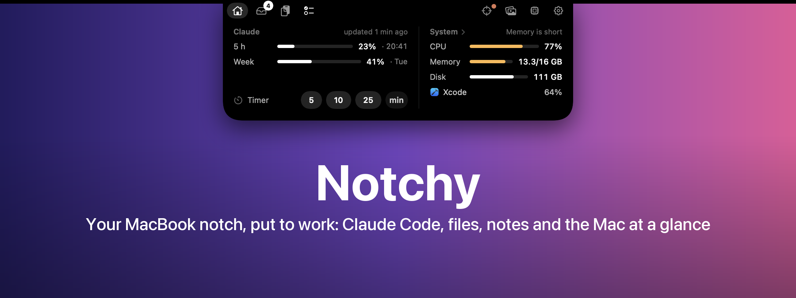
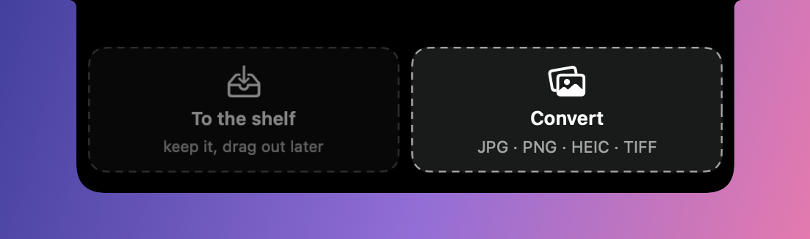
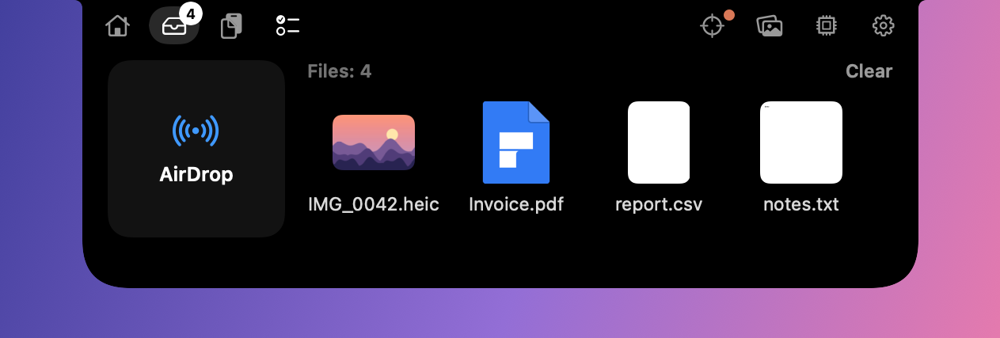
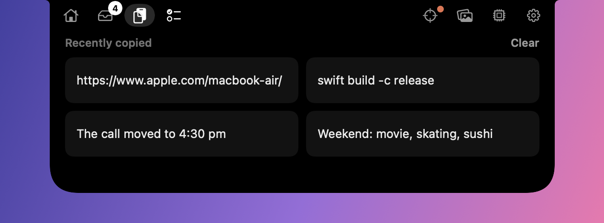
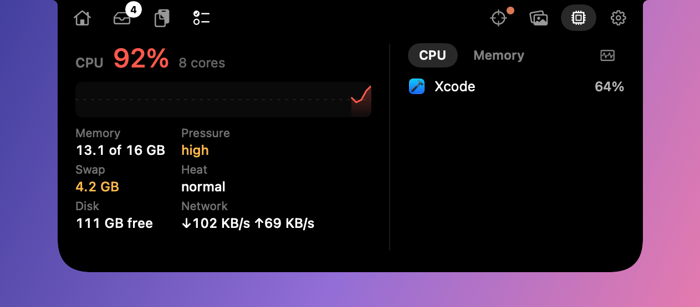
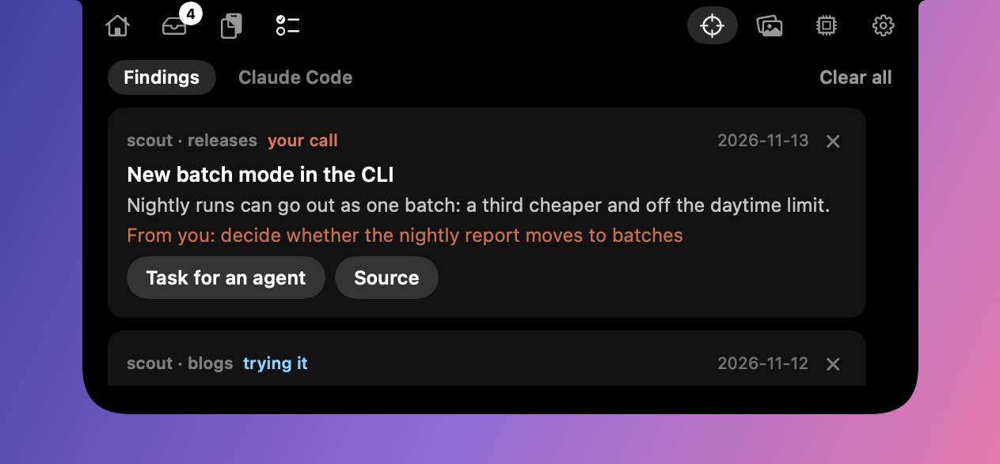

<p align="center"></p>

<p align="center">
  <a href="#install"></a>
  
  <a href="#claude-code-module"></a>
  <a href="LICENSE"></a>
</p>

<p align="center"><b>English</b> · <a href="README.ru.md">Русский</a></p>

Point at the notch and it grows into a panel: a timer, a file shelf, clipboard history, notes, an image converter and what the Mac is doing. Run Claude Code? When a session you're **not looking at** asks a question, finishes a plan or wants a permission, you answer right in the notch.

Native Swift, everything stays on your Mac, nothing the menu bar already shows.

## What it does

<table>
<tr>
<td width="50%"><br><b>Answer Claude from the notch.</b> Questions, plans and permissions from sessions that are off screen: options, your own answer, approve or send back a plan, allow or deny a tool.</td>
<td width="50%"><br><b>Drop files on it.</b> The notch splits in two: the left half keeps files on the shelf, the right one converts images.</td>
</tr>
<tr>
<td><br><b>Shelf.</b> Files wait with Quick Look previews, to be dragged out again or sent by AirDrop.</td>
<td><br><b>Converter.</b> HEIC from the iPhone to JPG, or between JPG, PNG, HEIC and TIFF, in one click. Copies land next to the originals.</td>
</tr>
<tr>
<td><br><b>Clipboard.</b> The last 30 copied texts; a click copies one back. In memory only, password managers are skipped.</td>
<td><br><b>Notes and tasks.</b> <i>To Notes</i> saves to the Notes app. Claude Code sessions can add tasks too.</td>
</tr>
<tr>
<td><br><b>The Mac at a glance.</b> CPU with a graph, memory pressure, swap, heat, disk, network and the apps behind the load.</td>
<td><br><b>Radar.</b> New Claude Code releases against the version you have, plus cards from your own scripts. <i>Task for an agent</i> copies a ready update task.</td>
</tr>
<tr>
<td><br><b>Timer.</b> 5, 10, 25 minutes or your own; the resting notch counts down.</td>
<td><br><b>Load alerts.</b> Only in serious cases the notch says what and who: CPU, memory pressure, heat, disk.</td>
</tr>
</table>

More: [plan card](docs/screenshots/en-plan.png) · [permission card](docs/screenshots/en-permission.png) · [banner](docs/screenshots/en-banner.png) · [Claude Code releases](docs/screenshots/en-radar-claude.png) · [converter tab](docs/screenshots/en-convert-tab.png)

The app speaks English and Russian: it follows the system language, or set `language` in the config.

## Install

```bash
git clone https://github.com/veeskelad/notchy.git
cd notchy
./scripts/install.sh --with-plugin
```

The installer builds `Notchy.app` with SwiftPM, puts it in `/Applications`, starts it and adds it to Login Items (`open_at_login` turns that off). `--with-plugin` also installs the Claude Code plugin; without it you can add the plugin later:

```bash
claude plugin marketplace add /path/to/notchy
claude plugin install notchy@notchy
```

New Claude Code sessions pick up the hooks; restart running ones.

**Requirements:** macOS 13+ on a MacBook with a notch (elsewhere the panel hangs from the middle of the menu bar), Swift 5.9+ (Xcode or `xcode-select --install`). For the Claude module: Claude Code with plugin hooks and Python 3.9+ on `PATH`. Translating Claude Code release notes needs macOS 26.

**Permissions** (System Settings):
- Privacy & Security → Accessibility → Notchy: lets it read the front IDE window title, so it knows which session you're looking at.
- Notifications → Notchy: only with `system_notifications`.

<details>
<summary>Keeping Accessibility across rebuilds</summary>

macOS ties the grant to the app's signature. The default ad-hoc signature changes with every build, so after a reinstall the switch stays on but no longer applies. A self-signed certificate fixes that once:

1. Keychain Access → Certificate Assistant → Create a Certificate… → name `Notchy Local Signing`, Identity Type *Self Signed Root*, Certificate Type *Code Signing*.
2. Run `./scripts/install.sh`; it signs with that certificate when it exists.
3. In Accessibility, remove the old Notchy entry with "−" and turn on the new one. Later reinstalls keep it.
</details>

<details>
<summary>Building by hand, uninstalling</summary>

```bash
swift build -c release          # the executable
./scripts/build-app.sh          # .build/app/Notchy.app, signed
open .build/app/Notchy.app
```

```bash
./scripts/install.sh --uninstall
```
</details>

## Claude Code module

On by default, a switch in Settings. Sessions report to the app through the plugin's hooks:

```
Claude Code ── plugin "notchy" (hooks) ──► notchy-hook.py
                                              │ Unix socket (0600)
                                              ▼
                                   Notchy.app
                                     ├─ is the session on screen? (front app, IDE window, terminal tab)
                                     ├─ no → banner, then a card with answers in the notch
                                     └─ usage: a hairline around the resting notch, the Home column
```

- **Only when you can't see it.** Nothing pops up for the session you're looking at.
- **No waiting.** `PermissionRequest` is the only hook that waits, and Claude Code shows its own dialog at the same time: answer wherever is closer. All other hooks are async. Headless runs (`claude -p`, Agent SDK) are ignored.
- **Usage.** Claude limits come from the `claude` CLI itself (the `get_usage` control request: no model call, no saved session, your hooks and MCP servers stay off). Codex limits come from `codex app-server`. Codex can be switched off; then the hairline is all Claude.
- **Notes for Claude.** The plugin's `notchy-notes` skill lets a session read the note and add tasks; they're marked with Claude's asterisk.

<details>
<summary>Feeding limits from the status line</summary>

Add this to the end of your status line script (the one in `statusLine.command`; needs `jq`):

```bash
# Notchy: share rate limits with the notch
rl=$(echo "$input" | jq -c 'select(.rate_limits != null) | {rate_limits, updated_at: (now | floor)}' 2>/dev/null)
if [ -n "$rl" ]; then
  n_dir="$HOME/Library/Application Support/Notchy"
  mkdir -p "$n_dir" 2>/dev/null && printf '%s\n' "$rl" > "$n_dir/.limits-claude.$$" 2>/dev/null \
    && mv -f "$n_dir/.limits-claude.$$" "$n_dir/limits-claude.json" 2>/dev/null || true
fi
```

`$input` is the JSON your script read from stdin. Rate limits are present for Pro/Max subscribers after the first response in a session.
</details>

<details>
<summary>Hiding the indicators (for the night or for a clean notch)</summary>

- **Settings** → *Indicators at the notch*.
- **Schedule:** `"quiet_hours": "23:00-07:00"` in the config.
- **Command:** `/Applications/Notchy.app/Contents/MacOS/Notchy -indicators hide|show|toggle|auto`. To follow the Sleep Focus, make two Shortcuts automations: *When Sleep turns on* → *Run Shell Script* with `-indicators hide`, *When Sleep turns off* → `-indicators auto`.

A choice made by hand wins until quiet hours next start or end; `auto` hands control back to the schedule. While hidden, a new request still drops out as a banner.
</details>

## Configuration

Most switches are in Settings (the gear in the panel). The rest lives in `~/.config/notchy/config.json`:

```json
{
  "claude_module": true,
  "system_alerts": true,
  "clipboard_history": true,
  "codex_limits": true,
  "claude_updates": true,
  "radar_command": "",
  "open_at_login": true,
  "sounds": { "question": "Glass", "plan_ready": "Glass", "tool_permission": "Funk", "idle": "Pop", "attention": "Funk", "error": "Basso" },
  "events": { "question": true, "plan_ready": true, "tool_permission": true, "idle": true, "attention": true, "error": true },
  "notch": true,
  "system_notifications": false,
  "notch_fallback_seconds": 20,
  "done_min_turn_seconds": 60,
  "away_idle_seconds": 120,
  "activate_app": "auto",
  "language": "auto",
  "quiet_hours": ""
}
```

| Key | Meaning |
|-----|---------|
| `claude_module` | `false` → a plain panel: no cards, limits or Claude column |
| `clipboard_history` | `false` → the Clipboard tab records nothing |
| `system_alerts` | Load alerts in the notch |
| `codex_limits` | `false` → no Codex usage; the hairline is all Claude |
| `claude_updates` | `false` → the Radar leaves out Claude Code releases (no request to GitHub) |
| `radar_command` | A shell command for the Radar's findings, run every 30 minutes (format below) |
| `claude_compact` | `true` → the resting notch widens while Claude works; off by default |
| `open_at_login` | Login item |
| `events.*` | `question`, `plan_ready`, `tool_permission`; `idle` ("Done" after a long turn); `attention` (Claude waits on an MCP form or a sandbox request); `error` (a turn failed) |
| `sounds.*` | macOS sound name per event, `"none"` for silence |
| `notch` | `false` → no panel, native notifications only |
| `system_notifications` | `true` → also native notifications: a request after `notch_fallback_seconds`, "Done" while you're away |
| `done_min_turn_seconds` | Shorter turns never produce a "Done" banner |
| `away_idle_seconds` | No keyboard or mouse for this long → every session counts as off screen |
| `activate_app` | `"auto"` (the app found per session) or a bundle ID |
| `language` | `"auto"`, `"en"` or `"ru"` |
| `quiet_hours` | `"23:00-07:00"` hides the Claude indicators in that range |
| `claude_path` / `codex_path` | CLIs for the limits; empty looks in Homebrew, `/usr/local/bin`, `~/.local/bin` |

Keys not in Settings take effect after a restart: `osascript -e 'quit app "Notchy"'`, then open it again. Waiting questions come back by themselves.

### Radar findings

`radar_command` runs through your login shell and prints one JSON object; only `title` is required:

```json
{"items": [{"id": "batch-mode", "source": "scout · releases", "title": "New batch mode in the CLI",
            "text": "Nightly runs can go out as one batch", "action": "decide whether to switch",
            "url": "https://…", "report": "/path/to/report.html", "date": "2026-11-13", "kind": "propose",
            "prompt": "…"}]}
```

`kind` picks the badge: `propose` (needs your decision), `probe` (being tried), `hold` (waiting on a condition). `action` is shown as what is needed from you; `prompt` is what *Task for an agent* copies (without it the task is built from the card).

## Privacy

- Everything runs on the Mac. The hook talks to the app over a Unix socket only you can open (0600).
- Network: the Claude Code changelog from `raw.githubusercontent.com` every 6 hours (`claude_updates: false` turns it off). Release notes are translated on the Mac by Apple Translation.
- Usage comes from the `claude` and `codex` CLIs you already signed in to; Notchy never sees their tokens.
- The clipboard history lives in memory and skips what password managers mark as concealed.
- Logs stay in `~/Library/Logs/Notchy/`.

## Troubleshooting

- **Nothing shows up:** `pgrep -fl Notchy.app`; check `~/Library/Logs/Notchy/notchy.log` and `hook.log`.
- **Hook not firing:** `claude plugin list` should show `notchy` enabled; restart the session.
- **Cards show for the window you're looking at:** grant Accessibility. `[init] accessibility=false` in the log while the switch is on means the grant belongs to an older build (see *Keeping Accessibility across rebuilds*).
- **Clicking a notification opens the wrong window:** set `activate_app` to your IDE's bundle ID.
- **Trying a build without touching the installed app:** `open -n -a .build/app/Notchy.app --env NOTCHY_HOME=/tmp/n --env NOTCHY_FORCE_OFFSCREEN=1` runs a separate instance with its own socket, config and logs under `/tmp/n`.

## Contributing

Issues and pull requests are welcome. Before a PR: `swift build -c release`, `python3 -m unittest discover -s tests`, and `claude plugin validate ./plugin` if you touched the plugin. Screenshots in `docs/` use made-up data only.

## License

[MIT](LICENSE) © veeskelad
