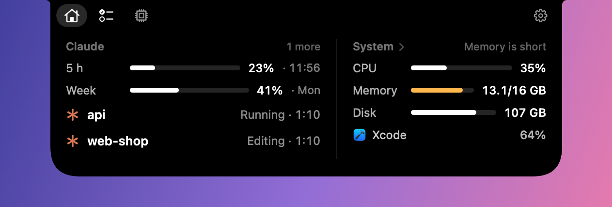
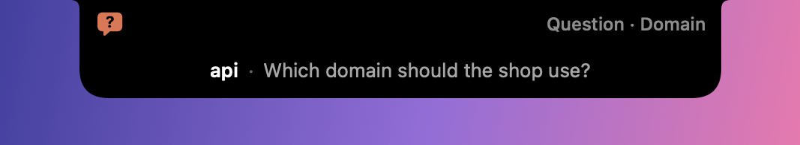
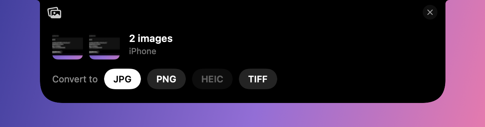
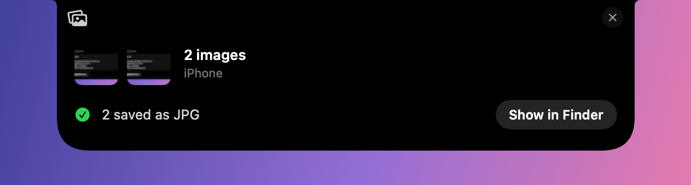
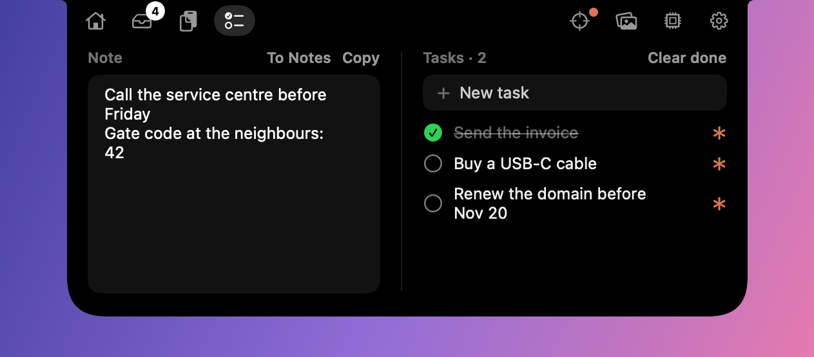
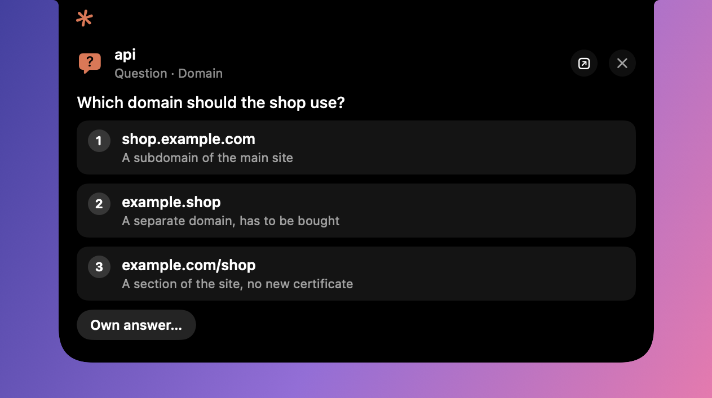
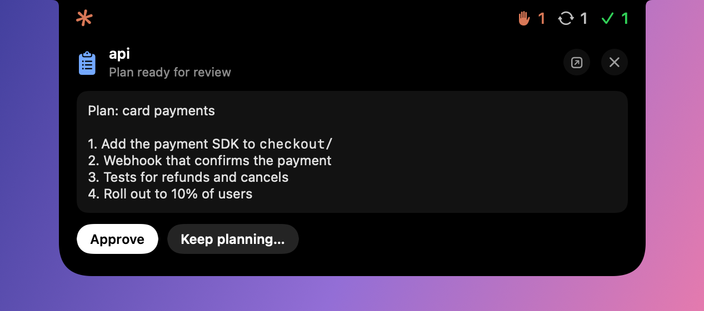
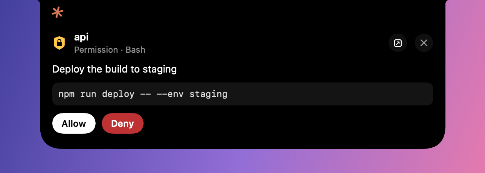

# Notchy

**English** · [Русский](README.ru.md)

A MacBook notch that works: point at the cutout and it grows into a panel with your AI tools and what the Mac is doing. Claude Code sessions report to it, and when one that is **not on your screen** asks a question, finishes a plan or needs a permission, you answer right in the notch. Nothing the menu bar already shows (time, battery).

<p></p>

- **Panel** — point at the notch: tabs and settings level with the cutout; *Home* has Claude on the left and the Mac at a glance on the right
- **Image converter** — drop images on the notch and click a format: HEIC from the iPhone to JPG, or between JPG, PNG, HEIC and TIFF (WebP where macOS can write it). Copies land next to the originals with metadata and orientation kept
- **Notes and tasks** — a note and a task list in the panel; Claude Code sessions can read them and add tasks too (the `notchy-notes` skill in the plugin), marked with Claude's asterisk
- **System tab** — CPU with a 2-minute graph, memory and its pressure, swap, heat, disk, network, and the apps behind the load (helpers count towards their app), by CPU or by memory
- **Load alerts** — only in serious cases the notch widens with the cause and the app behind it: CPU above 90% for a minute, critical memory pressure, overheating, under 5 GB of disk; milder ones (high memory pressure, a warm Mac, under 10 GB) show inside the panel. Once you've looked it stays away until it clears or gets worse
- **Claude module** (on by default, a switch in Settings):
  - **Answer from the notch** — options with descriptions, "own answer", multi-select, several questions in a row; approve a plan or send it back with feedback; allow or deny a tool
  - **Only when you can't see it** — nothing pops up for the session you are looking at (frontmost app, IDE window title, terminal tab)
  - **Session status** — the Claude column lists sessions with what they do ("Editing · 1:24", "Done · 7 min ago")
  - **Limits** — Claude and Codex usage with reset times; a hairline around the resting notch fills with them (Codex can be switched off, then the line is all Claude)
- **Native macOS app** — Swift (AppKit + SwiftUI), lives in `/Applications`, starts at login, no Dock icon; the Claude Code hook is Python 3.9+ stdlib

The app speaks English and Russian: it follows the system language, or set `language` in the config.

## Screenshots

At rest the notch keeps its size (with `claude_compact` it widens while Claude works, left); a request from a session you're not looking at drops out as a banner:

<p> </p>

Drop images on the notch to convert them:

<p></p>
<p></p>

A note and tasks; Claude can add to them from any session:

<p></p>

When the Mac is under load, the notch says what and who:

<p></p>

Point at the notch to answer it, approve a plan or allow a tool:

<p></p>
<p></p>
<p></p>

## How It Works

```
Claude Code ── plugin "notchy" (hooks) ──► notchy-hook.py
                                              │ Unix socket (0600)
                                              ▼
                                   Notchy.app (/Applications, login item)
                                     ├─ panel: Home (Claude · the Mac) · Notes · System · load alerts
                                     ├─ drop zone: image converter
                                     ├─ Claude module: is the session on screen?
                                     │    → banner · card with answers · counts · limits
                                     └─ native notification as an optional fallback
```

- `PermissionRequest` is the only hook that waits. Claude Code shows its dialog at the same time, so answering in the session works as usual and releases the hook.
- All other hooks run `async` — Claude never waits for them. With the Claude module off, a waiting hook gets "no decision" at once.
- Headless runs (`claude -p`, Agent SDK) are ignored.

## Installation

```bash
git clone https://github.com/veeskelad/notchy.git
cd notchy
./scripts/install.sh --with-plugin
```

The installer builds `Notchy.app` with SwiftPM (`swift build`), puts it in `/Applications` and starts it; the app adds itself to Login Items (`open_at_login` turns that off). With `--with-plugin` it also registers this repo as a plugin marketplace and installs the `notchy` plugin. Without the flag it prints the two commands:

```bash
claude plugin marketplace add /path/to/notchy
claude plugin install notchy@notchy
```

New Claude Code sessions pick up the hooks; restart running ones.

**Coming from Claude Notify** (the old name): the installer removes its LaunchAgent, app and plugin; Notchy copies the config (`~/.config/claude-notify/` → `~/.config/notchy/`) and state on first launch. macOS sees Notchy as a new app, so grant the permissions below once more.

**Permissions** (System Settings):
- Notifications → Notchy → allow (needed only with `system_notifications`)
- Privacy & Security → Accessibility → Notchy — lets it read the front IDE window title. Without it, a frontmost IDE counts as "you are looking".

**Keeping Accessibility across rebuilds.** macOS ties the grant to the app's signature. The default ad-hoc signature changes with every build, so after a reinstall the switch stays on but no longer applies. A self-signed certificate fixes that once:
1. Keychain Access → Certificate Assistant → Create a Certificate… → name `Notchy Local Signing`, Identity Type *Self Signed Root*, Certificate Type *Code Signing*.
2. Run `./scripts/install.sh`; it signs with that certificate when it exists (allow `codesign` to use the key if asked).
3. In Accessibility, remove the old Notchy entry with "−" and turn on the new one. Later reinstalls keep it.

### Building by hand

```bash
swift build -c release          # the executable
./scripts/build-app.sh          # .build/app/Notchy.app, signed
open .build/app/Notchy.app
```

Full Xcode or the Command Line Tools both work (`xcode-select --install`).

### Limits

Codex limits come from Codex itself: every few minutes, and when the panel opens, the app asks `codex app-server` for the account's limits (the same data the Codex apps show), so usage from other machines and the cloud counts too. It needs the `codex` CLI signed in with ChatGPT; Codex keeps the sign-in to itself. Without it, the latest limits from Codex's session logs (`~/.codex/sessions`) are shown.

Claude limits come from Claude Code itself: whenever any Claude Code session is active, and when the panel opens, the app asks the `claude` CLI for the account's usage through its SDK control request `get_usage` — headless, without your hooks or MCP servers, no model call, no saved session. It needs `claude` signed in with a Claude subscription. The status line can feed the notch too; add this to the end of your status line script (the one in `statusLine.command`; needs `jq`):

```bash
# Notchy: share rate limits with the notch
rl=$(echo "$input" | jq -c 'select(.rate_limits != null) | {rate_limits, updated_at: (now | floor)}' 2>/dev/null)
if [ -n "$rl" ]; then
  n_dir="$HOME/Library/Application Support/Notchy"
  mkdir -p "$n_dir" 2>/dev/null && printf '%s\n' "$rl" > "$n_dir/.limits-claude.$$" 2>/dev/null \
    && mv -f "$n_dir/.limits-claude.$$" "$n_dir/limits-claude.json" 2>/dev/null || true
fi
```

`$input` is the JSON your script read from stdin. Rate limits are only present for Pro/Max subscribers and appear after the first response in a session.

### Hiding the indicators

The Claude indicators at the notch (the usage hairline, the waiting-request dot and the compact "at work" state) can be switched off, for the night or just to keep the notch clean:

- **Settings** — the gear in the panel → *Indicators at the notch*.
- **Schedule** — `"quiet_hours": "23:00-07:00"` in the config hides them in that range (it may run past midnight).
- **Command** — `Notchy -indicators hide|show|toggle|auto` talks to the running app:

  ```bash
  /Applications/Notchy.app/Contents/MacOS/Notchy -indicators hide
  ```

  To follow the Sleep Focus, make two automations in Shortcuts: *When Sleep turns on* → *Run Shell Script* with `-indicators hide`, *When Sleep turns off* → the same with `-indicators auto`.

A choice made by hand wins until quiet hours next start or end; `auto` hands control back to the schedule at once. The choice survives restarts. While they are hidden a new request still drops out as a banner; point at the notch to find it afterwards.

### Requirements

- macOS 13+, a MacBook with a notch (on other screens the panel hangs from the middle of the menu bar)
- Swift 5.9+ (Xcode or the Command Line Tools)
- For the Claude module: Claude Code with plugin hooks (tested on 2.1.284), Python 3.9+ on `PATH`

### Uninstall

```bash
./scripts/install.sh --uninstall
```

## Configuration

Most switches are in Settings (the gear in the panel). The rest lives in `~/.config/notchy/config.json`:

```json
{
  "claude_module": true,
  "system_alerts": true,
  "codex_limits": true,
  "open_at_login": true,
  "sounds": { "question": "Glass", "plan_ready": "Glass", "tool_permission": "Funk", "idle": "Pop", "attention": "Funk", "error": "Basso" },
  "events": { "question": true, "plan_ready": true, "tool_permission": true, "idle": true, "attention": true, "error": true },
  "notch": true,
  "system_notifications": false,
  "notch_fallback_seconds": 20,
  "done_min_turn_seconds": 60,
  "away_idle_seconds": 120,
  "activate_app": "auto",
  "language": "auto",
  "quiet_hours": ""
}
```

| Key | Meaning |
|-----|---------|
| `claude_module` | `false` → a plain panel: no cards, counts, limits or Claude column (Settings → *Claude module*) |
| `system_alerts` | Load alerts in the notch (Settings → *Load alerts*) |
| `codex_limits` | `false` → no Codex usage; the line around the notch is all Claude (Settings → *Codex usage*) |
| `claude_compact` | `true` → the resting notch widens while Claude works, with the counts; off by default |
| `open_at_login` | Login item (Settings → *Open at login*) |
| `events.question` / `plan_ready` / `tool_permission` | Questions, plans, tool permissions |
| `events.idle` | "Done" after a long turn |
| `events.attention` / `error` | Claude waits on something else (MCP form, sandbox network request) / a turn failed with an API error |
| `sounds.*` | macOS sound name per event, `"none"` for silence |
| `notch` | `false` → no panel at all, native notifications only |
| `system_notifications` | `true` → also native notifications: a request after `notch_fallback_seconds`, "Done" while you're away |
| `notch_fallback_seconds` | Seconds before an unanswered request also becomes a native notification (with `system_notifications`) |
| `done_min_turn_seconds` | Shorter turns never produce a "Done" banner |
| `away_idle_seconds` | No keyboard/mouse for this long → every session counts as off screen |
| `activate_app` | `"auto"` (app found per session) or a bundle ID |
| `language` | `"auto"`, `"en"` or `"ru"` |
| `quiet_hours` | `"23:00-07:00"` hides the Claude indicators in that range; empty: never |
| `claude_path` / `codex_path` | CLIs for the limits; empty looks in Homebrew, `/usr/local/bin`, `~/.local/bin` |

Keys not in Settings take effect after a restart: quit Notchy (`osascript -e 'quit app "Notchy"'`) and open it again. Questions that were waiting come back by themselves.

## Troubleshooting

- **Nothing shows up** — `pgrep -fl Notchy.app`; check `~/Library/Logs/Notchy/notchy.log` and `hook.log`.
- **Hook not firing** — `claude plugin list` should show `notchy` enabled; restart the session.
- **Trying it without touching the installed app** — `open -n -a .build/app/Notchy.app --env NOTCHY_HOME=/tmp/n --env NOTCHY_FORCE_OFFSCREEN=1` runs a separate instance with its own socket, config and logs under `/tmp/n`; send it hook input with `HOME=/tmp/n`.
- **Cards show for the window you're looking at** — grant Accessibility; `[init] accessibility=false` in the log while the switch is on means the grant belongs to an older build (see *Keeping Accessibility across rebuilds*).
- **Clicking a notification opens the wrong window** — set `activate_app` to your IDE's bundle ID.

## License

[MIT](LICENSE)
