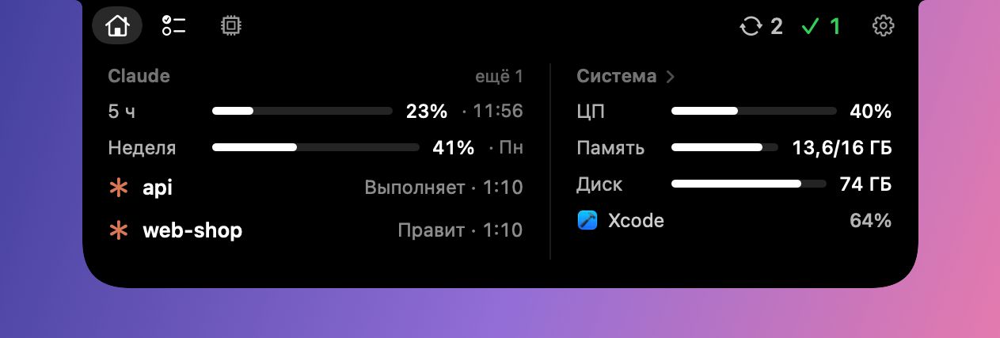
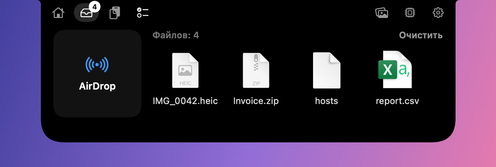
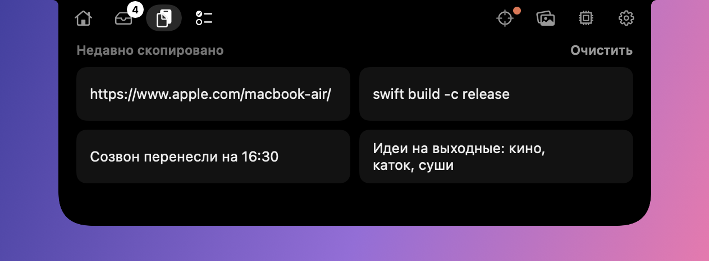
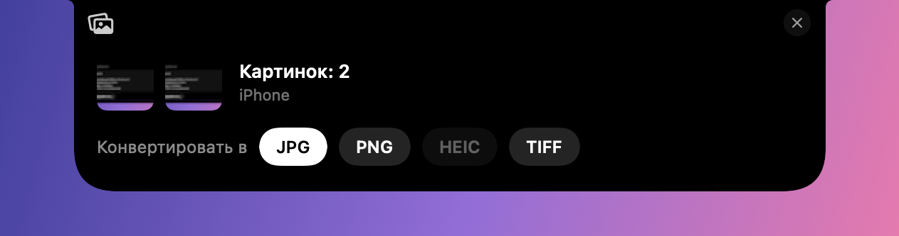
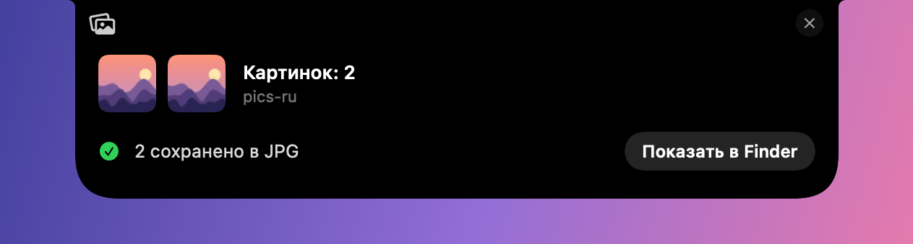
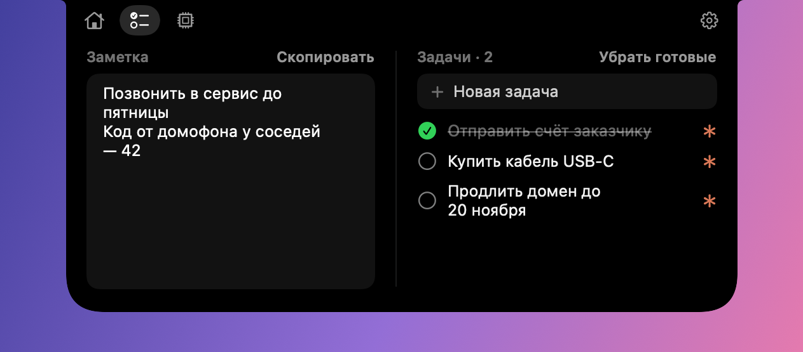
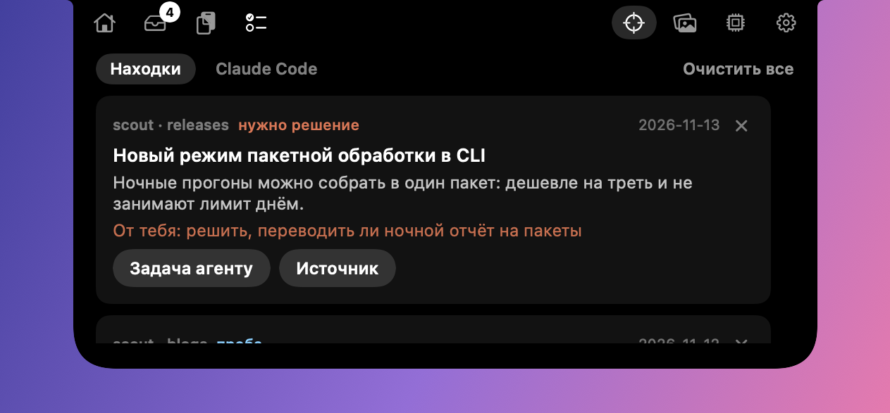
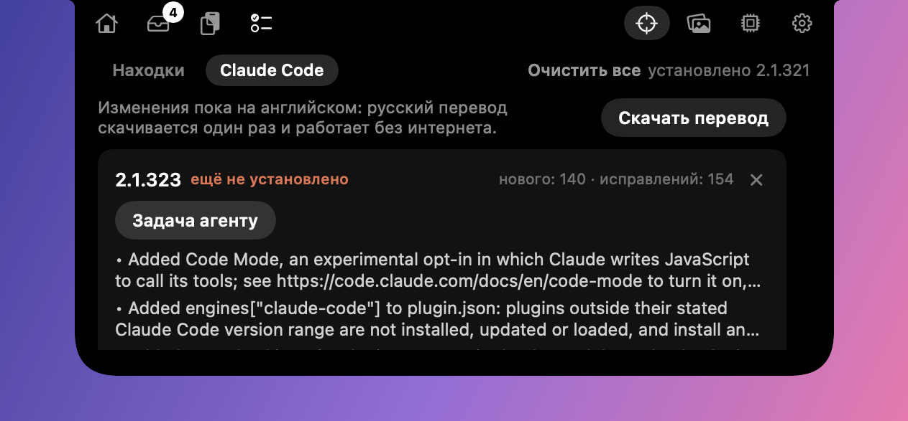
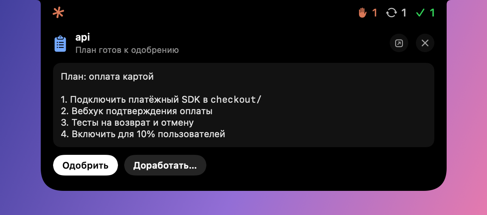
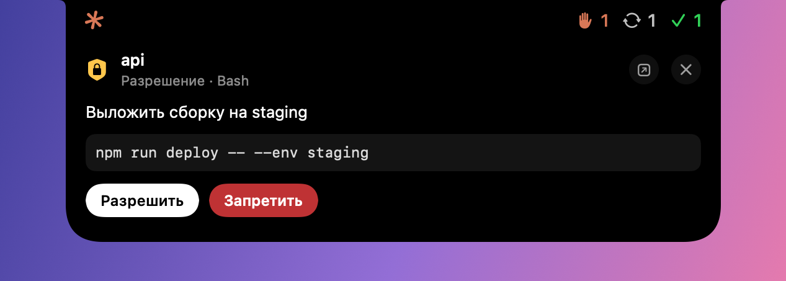

# Notchy

[English](README.md) · **Русский**

Чёлка MacBook, которая работает. Наведите на вырез, и он раскроется в панель: ИИ-инструменты и то, чем занят Mac. Сессии Claude Code сообщают ей о себе. Когда сессия, которой **нет на экране**, задаёт вопрос, готовит план или просит разрешение, отвечаете прямо в чёлке. Того, что уже есть в строке меню (время, батарея), здесь нет.

<p></p>

- **Панель** — наведите на чёлку. В строке выреза вкладки и настройки; на «Главной» слева лимиты Claude, справа сводка по Mac.
- **Таймер** — 5, 10, 25 минут или своё время на «Главной». Пока идёт, в свёрнутой чёлке обратный отсчёт; в конце звук и баннер.
- **Полка** — перетащите файлы на левую половину чёлки: они полежат на вкладке «Полка» с превью Quick Look, откуда их можно перетащить дальше (превью едет вместе с файлом) или отправить по AirDrop.
- **Буфер обмена** — последние 30 скопированных текстов, клик копирует снова. Хранятся только в памяти, пароли из менеджеров паролей не записываются.
- **Конвертер картинок** — перетащите картинки на правую половину чёлки (или откройте вкладку «Конвертер») и нажмите формат: HEIC с iPhone в JPG или между JPG, PNG, HEIC и TIFF (WebP — если macOS умеет его записывать). Копии ложатся рядом с оригиналами, метаданные и ориентация сохраняются.
- **Заметки и задачи** — заметка и список дел в панели, кнопка «В Заметки» сохраняет заметку в приложение «Заметки». Сессии Claude Code тоже читают их и добавляют задачи (скилл `notchy-notes` в плагине), такие задачи помечены звёздочкой Claude.
- **Радар** — что нового стоит посмотреть: последние версии Claude Code из открытого списка изменений с пометкой, что у вас ещё не установлено, и, если хотите, карточки от ваших собственных скриптов (`radar_command`: бот-исследователь, слежка за релизами, что угодно, что печатает JSON). Точка на вкладке — есть непросмотренное. Карточку убирает её ×, весь список — «Очистить все» («Вернуть» возвращает). «Задача агенту» копирует готовую задачу: что изменилось, что это значит для вашего продукта и смежных проектов, инструкция для агентов по обновлению — вставьте её в Claude Code или Codex.
- **Вкладка «Система»** — процессор с графиком за 2 минуты, память и её давление, своп, нагрев, диск, сеть и приложения, которые грузят (вспомогательные процессы считаются за своё приложение), по ЦП или по памяти.
- **Предупреждения о нагрузке** — только в серьёзных случаях чёлка расширяется и показывает причину и виновника: ЦП дольше минуты выше 90%, критическое давление памяти, перегрев, на диске меньше 5 ГБ. Мягкие (высокое давление памяти, Mac нагрет, меньше 10 ГБ) видны только в панели. После того как вы посмотрели, предупреждение не возвращается, пока не пройдёт или не станет хуже.
- **Модуль Claude** (включён по умолчанию, выключатель в настройках):
  - **Ответ из чёлки** — варианты с описаниями, «свой ответ», выбор нескольких, несколько вопросов подряд; одобрить план или вернуть с замечаниями; разрешить или запретить инструмент.
  - **Только когда не видно** — для сессии, на которую вы смотрите, ничего не всплывает (активное приложение, заголовок окна IDE, вкладка терминала).
  - **Лимиты** — расход Claude и Codex со временем сброса. В покое ими заполняется тонкая обводка вокруг выреза. Codex можно выключить — тогда обводка целиком для Claude.
- **Нативное приложение macOS** — Swift (AppKit + SwiftUI), лежит в `/Applications`, запускается при входе, без иконки в Dock. Хук Claude Code — Python 3.9+ без зависимостей.

Приложение говорит по-русски и по-английски: язык берётся из системы или из ключа `language` в конфиге.

## Скриншоты

В покое чёлка своего размера (с `claude_compact` она расширяется, пока Claude работает, — слева). Запрос из сессии, которой нет на экране, выпадает баннером:

<p> </p>

Таймер в свёрнутой чёлке, полка и буфер обмена:

<p></p>
<p></p>
<p></p>

Тащите файл на чёлку — она делится пополам: левая половина кладёт его на полку, правая конвертирует:

<p></p>

Конвертер после того, как картинку отпустили:

<p></p>
<p></p>

Заметка и задачи; Claude дописывает их из любой сессии:

<p></p>

Радар: находки ваших скриптов и что нового в свежем Claude Code:

<p></p>
<p></p>

Когда Mac под нагрузкой, чёлка говорит, что и кто:

<p></p>

Наведите на чёлку, чтобы ответить, одобрить план или разрешить инструмент:

<p></p>
<p></p>
<p></p>

## Как это устроено

```
Claude Code ── плагин «notchy» (хуки) ──► notchy-hook.py
                                             │ Unix-сокет (0600)
                                             ▼
                                  Notchy.app (/Applications, объект входа)
                                    ├─ панель: «Главная» (Claude · таймер · Mac) · «Полка» · «Буфер» · «Заметки»
                                    │          · «Радар» · «Конвертер» · «Система» · предупреждения
                                    ├─ зоны перетаскивания: полка (слева) · конвертер (справа)
                                    ├─ модуль Claude: видна ли сессия?
                                    │    → баннер · карточка с ответами · счётчики · лимиты
                                    └─ системное уведомление как запасной путь (по желанию)
```

- Ждёт ответа только хук `PermissionRequest`. Claude Code одновременно показывает свой диалог, поэтому ответ в самой сессии работает как обычно и отпускает хук.
- Остальные хуки работают `async`, Claude их не ждёт. Если модуль Claude выключен, ждущий хук сразу получает «решения нет».
- Запуски без интерфейса (`claude -p`, Agent SDK) пропускаются.

## Установка

```bash
git clone https://github.com/veeskelad/notchy.git
cd notchy
./scripts/install.sh --with-plugin
```

Установщик собирает `Notchy.app` через SwiftPM (`swift build`), кладёт в `/Applications` и запускает. Приложение само добавляется в объекты входа, ключ `open_at_login` это выключает. С флагом `--with-plugin` установщик ещё регистрирует репозиторий как маркетплейс плагинов и ставит плагин `notchy`. Без флага он выведет две команды:

```bash
claude plugin marketplace add /path/to/notchy
claude plugin install notchy@notchy
```

Новые сессии Claude Code подхватят хуки, запущенные нужно перезапустить.

**Переход с Claude Notify** (старое название). Установщик убирает его LaunchAgent, приложение и плагин. Notchy при первом запуске копирует конфиг (`~/.config/claude-notify/` → `~/.config/notchy/`) и состояние. Для macOS Notchy — новое приложение, поэтому разрешения ниже придётся выдать заново.

**Разрешения** (Системные настройки):
- Уведомления → Notchy → разрешить (нужно только с `system_notifications`).
- Конфиденциальность и безопасность → Универсальный доступ → Notchy. Так приложение видит заголовок окна IDE на переднем плане. Без доступа IDE на переднем плане считается «вы смотрите».

**Как сохранить универсальный доступ между сборками.** macOS привязывает разрешение к подписи приложения. Подпись по умолчанию (ad-hoc) меняется с каждой сборкой, и после переустановки переключатель горит, но уже не действует. Самоподписанный сертификат решает это один раз:
1. Связка ключей → Ассистент сертификации → Создать сертификат… → имя `Notchy Local Signing`, тип удостоверения «Самоподписанный корневой», тип сертификата «Подпись кода».
2. Запустите `./scripts/install.sh`: если сертификат есть, установщик подпишет им (разрешите `codesign` доступ к ключу, если спросит).
3. В «Универсальном доступе» удалите старую строку Notchy кнопкой «−» и включите новую. Следующие переустановки её сохранят.

### Сборка вручную

```bash
swift build -c release          # исполняемый файл
./scripts/build-app.sh          # .build/app/Notchy.app с подписью
open .build/app/Notchy.app
```

Подойдёт и полный Xcode, и Command Line Tools (`xcode-select --install`).

### Лимиты

Лимиты Codex приходят от самого Codex. Раз в несколько минут и при открытии панели приложение спрашивает у `codex app-server` лимиты аккаунта — те же данные, что показывают приложения Codex. Поэтому учитывается и расход с других машин, и облачный. Нужен CLI `codex`, вошедший через ChatGPT; вход остаётся у Codex. Без него показываются последние лимиты из журналов сессий Codex (`~/.codex/sessions`).

Лимиты Claude приходят от самого Claude Code. Когда какая-нибудь сессия Claude Code активна и когда открывается панель, приложение спрашивает расход аккаунта у CLI `claude` управляющим запросом SDK `get_usage`. Запрос идёт без интерфейса, без ваших хуков и MCP-серверов, без вызова модели и без сохранения сессии. Нужен `claude`, вошедший с подпиской Claude. Чёлку может кормить и строка статуса: добавьте в конец её скрипта (того, что в `statusLine.command`; нужен `jq`):

```bash
# Notchy: передать лимиты в чёлку
rl=$(echo "$input" | jq -c 'select(.rate_limits != null) | {rate_limits, updated_at: (now | floor)}' 2>/dev/null)
if [ -n "$rl" ]; then
  n_dir="$HOME/Library/Application Support/Notchy"
  mkdir -p "$n_dir" 2>/dev/null && printf '%s\n' "$rl" > "$n_dir/.limits-claude.$$" 2>/dev/null \
    && mv -f "$n_dir/.limits-claude.$$" "$n_dir/limits-claude.json" 2>/dev/null || true
fi
```

`$input` — JSON, который скрипт прочитал из stdin. Лимиты есть только у подписчиков Pro и Max и появляются после первого ответа в сессии.

### Как спрятать индикаторы

Индикаторы Claude у выреза (обводку лимитов, точку ждущего запроса и плашку «работает») можно выключить — на ночь или просто чтобы чёлка была чистой:

- **Настройки** — шестерёнка в панели → «Индикаторы у выреза».
- **Расписание** — `"quiet_hours": "23:00-07:00"` в конфиге прячет их в этом промежутке (он может переходить через полночь).
- **Команда** — `Notchy -indicators hide|show|toggle|auto` передаёт команду запущенному приложению:

  ```bash
  /Applications/Notchy.app/Contents/MacOS/Notchy -indicators hide
  ```

  Чтобы индикаторы следовали за фокусом «Сон», сделайте в «Быстрых командах» две автоматизации: «Когда включается Сон» → «Запустить скрипт оболочки» с `-indicators hide`, «Когда выключается Сон» → то же с `-indicators auto`.

Выбор, сделанный вручную, действует до ближайшего начала или конца тихих часов; `auto` сразу возвращает управление расписанию. Выбор переживает перезапуск. Пока индикаторы спрятаны, новый запрос всё равно выпадает баннером, а потом его можно найти, наведя на чёлку.

### Требования

- macOS 13+, MacBook с чёлкой (на других экранах панель свисает из середины строки меню)
- Swift 5.9+ (Xcode или Command Line Tools)
- Для модуля Claude: Claude Code с хуками плагинов (проверено на 2.1.284), Python 3.9+ в `PATH`

### Удаление

```bash
./scripts/install.sh --uninstall
```

## Настройки

Основные переключатели — в настройках (шестерёнка в панели). Остальное — в `~/.config/notchy/config.json`:

```json
{
  "claude_module": true,
  "system_alerts": true,
  "clipboard_history": true,
  "codex_limits": true,
  "claude_updates": true,
  "radar_command": "",
  "open_at_login": true,
  "sounds": { "question": "Glass", "plan_ready": "Glass", "tool_permission": "Funk", "idle": "Pop", "attention": "Funk", "error": "Basso" },
  "events": { "question": true, "plan_ready": true, "tool_permission": true, "idle": true, "attention": true, "error": true },
  "notch": true,
  "system_notifications": false,
  "notch_fallback_seconds": 20,
  "done_min_turn_seconds": 60,
  "away_idle_seconds": 120,
  "activate_app": "auto",
  "language": "auto",
  "quiet_hours": ""
}
```

| Ключ | Что значит |
|------|------------|
| `claude_module` | `false` — просто панель: без карточек, счётчиков, лимитов и колонки Claude (Настройки → «Модуль Claude») |
| `clipboard_history` | `false` — вкладка «Буфер обмена» ничего не запоминает (Настройки → «История буфера обмена») |
| `system_alerts` | Предупреждения о нагрузке в чёлке (Настройки → «Предупреждения о нагрузке») |
| `claude_updates` | `false` — «Радар» без версий Claude Code (и без запроса к GitHub) |
| `radar_command` | Команда для находок «Радара», запускается раз в 30 минут; пусто — находок нет (формат ниже) |
| `codex_limits` | `false` — без лимитов Codex, обводка вокруг выреза целиком для Claude (Настройки → «Лимиты Codex») |
| `claude_compact` | `true` — чёлка в покое расширяется, пока Claude работает, и показывает счётчики; по умолчанию выключено |
| `open_at_login` | Объект входа (Настройки → «Открывать при входе в систему») |
| `events.question` / `plan_ready` / `tool_permission` | Вопросы, планы, разрешения на инструменты |
| `events.idle` | «Готово» после долгого хода |
| `events.attention` / `error` | Claude ждёт чего-то другого (форма MCP, сетевой запрос песочницы) / ход упал с ошибкой API |
| `sounds.*` | Имя системного звука для события, `"none"` — без звука |
| `notch` | `false` — панели нет совсем, только системные уведомления |
| `system_notifications` | `true` — ещё и системные уведомления: запрос через `notch_fallback_seconds`, «Готово», пока вас нет |
| `notch_fallback_seconds` | Через сколько секунд запрос без ответа становится и системным уведомлением (при `system_notifications`) |
| `done_min_turn_seconds` | Ходы короче этого не дают баннер «Готово» |
| `away_idle_seconds` | Столько без клавиатуры и мыши — и все сессии считаются не на экране |
| `activate_app` | `"auto"` (приложение определяется для каждой сессии) или bundle ID |
| `language` | `"auto"`, `"en"` или `"ru"` |
| `quiet_hours` | `"23:00-07:00"` прячет индикаторы Claude в этом промежутке; пусто — никогда |
| `claude_path` / `codex_path` | CLI для лимитов; пусто — поиск в Homebrew, `/usr/local/bin`, `~/.local/bin` |

Ключи, которых нет в настройках, действуют после перезапуска: закройте Notchy (`osascript -e 'quit app "Notchy"'`) и откройте снова. Ждавшие вопросы вернутся сами.

### Находки для «Радара»

`radar_command` запускается через ваш login shell и печатает один JSON-объект; обязательно только поле `title`:

```json
{"items": [{"id": "batch-mode", "source": "scout · releases", "title": "Новый пакетный режим в CLI",
            "text": "Ночные прогоны можно собрать в один пакет", "action": "решить, переходить ли",
            "url": "https://…", "report": "/путь/к/отчёту.html", "date": "2026-11-13", "kind": "propose"}]}
```

`kind` выбирает пометку: `propose` — нужно ваше решение, `probe` — идёт проба, `hold` — ждёт условия; `action` показывается как «От тебя»; `prompt` — то, что копирует «Задача агенту» (без него задача собирается из карточки). Команда работает локально, её вывод остаётся на Mac.

## Если что-то не так

- **Ничего не появляется** — `pgrep -fl Notchy.app`; смотрите `~/Library/Logs/Notchy/notchy.log` и `hook.log`.
- **Хук не срабатывает** — в `claude plugin list` плагин `notchy` должен быть включён; перезапустите сессию.
- **Попробовать, не трогая установленное приложение** — `open -n -a .build/app/Notchy.app --env NOTCHY_HOME=/tmp/n --env NOTCHY_FORCE_OFFSCREEN=1` запускает отдельный экземпляр со своими сокетом, конфигом и логами в `/tmp/n`. Вход хука ему отправляйте с `HOME=/tmp/n`.
- **Карточки показываются для окна, на которое вы смотрите** — выдайте универсальный доступ. Если переключатель включён, а в логе `[init] accessibility=false`, разрешение относится к старой сборке (см. «Как сохранить универсальный доступ между сборками»).
- **Клик по уведомлению открывает не то окно** — укажите в `activate_app` bundle ID своей IDE.

## Лицензия

[MIT](LICENSE)
