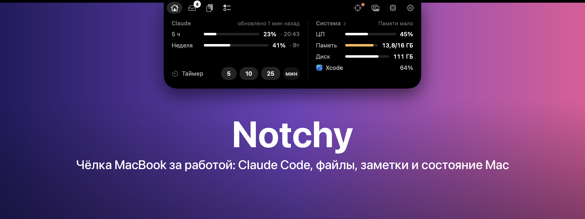
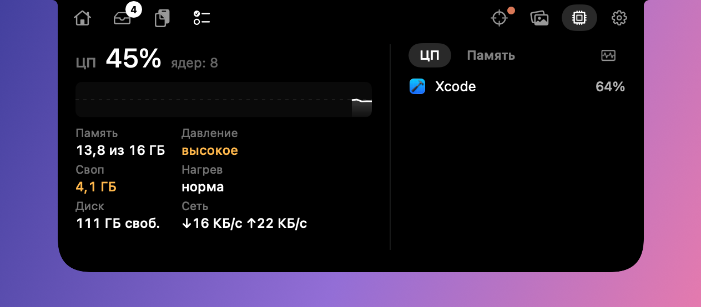

<p align="center"></p>

<p align="center">
  <a href="#установка"></a>
  
  <a href="#модуль-claude-code"></a>
  <a href="LICENSE"></a>
</p>

<p align="center"><a href="README.md">English</a> · <b>Русский</b></p>

Наведите курсор на чёлку, и она раскроется в панель: таймер, полка для файлов, история буфера обмена, заметки, конвертер картинок и состояние Mac. Работаете с Claude Code? Когда сессия, которую вы **сейчас не видите**, задаёт вопрос, заканчивает план или просит разрешение, ответить можно прямо в чёлке.

Нативный Swift, всё остаётся на вашем Mac, ничего из того, что уже есть в строке меню.

## Что умеет

<table>
<tr>
<td width="50%"><br><b>Ответить Claude из чёлки.</b> Вопросы, планы и разрешения от сессий, которых нет на экране: варианты, свой ответ, одобрить план или вернуть на доработку, разрешить или запретить инструмент.</td>
<td width="50%"><br><b>Бросьте файл на чёлку.</b> Она делится пополам: левая половина кладёт файлы на полку, правая конвертирует картинки.</td>
</tr>
<tr>
<td><br><b>Полка.</b> Файлы лежат с превью Quick Look, их можно перетащить дальше или отправить по AirDrop.</td>
<td><br><b>Конвертер.</b> HEIC с iPhone в JPG или между JPG, PNG, HEIC и TIFF в один клик. Копии ложатся рядом с оригиналами.</td>
</tr>
<tr>
<td><br><b>Буфер обмена.</b> Последние 30 скопированных текстов, клик копирует обратно. Только в памяти, менеджеры паролей пропускаются.</td>
<td><br><b>Заметки и задачи.</b> «В Заметки» сохраняет в приложение «Заметки». Сессии Claude Code тоже добавляют задачи.</td>
</tr>
<tr>
<td><br><b>Mac одним взглядом.</b> ЦП с графиком, давление памяти, своп, нагрев, диск, сеть и приложения, которые дают нагрузку.</td>
<td><br><b>Радар.</b> Новые версии Claude Code против установленной и карточки от ваших скриптов. «Задача агенту» копирует готовую задачу на обновление.</td>
</tr>
<tr>
<td><br><b>Таймер.</b> 5, 10, 25 минут или своё время; чёлка в покое показывает отсчёт.</td>
<td><br><b>Предупреждения о нагрузке.</b> Только в серьёзных случаях чёлка говорит, что и кто: ЦП, память, нагрев, диск.</td>
</tr>
</table>

Ещё: [план](docs/screenshots/ru-plan.png) · [разрешение](docs/screenshots/ru-permission.png) · [баннер](docs/screenshots/ru-banner.png) · [версии Claude Code](docs/screenshots/ru-radar-claude.png) · [вкладка конвертера](docs/screenshots/ru-convert-tab.png)

Приложение говорит по-английски и по-русски: следует языку системы, либо задайте `language` в конфиге.

## Установка

```bash
git clone https://github.com/veeskelad/notchy.git
cd notchy
./scripts/install.sh --with-plugin
```

Установщик собирает `Notchy.app` через SwiftPM, кладёт в `/Applications`, запускает и добавляет в объекты входа (`open_at_login` это выключает). `--with-plugin` ставит и плагин Claude Code; без флага его можно добавить позже:

```bash
claude plugin marketplace add /путь/к/notchy
claude plugin install notchy@notchy
```

Новые сессии Claude Code подхватят хуки сами, запущенные нужно перезапустить.

**Требования:** macOS 13+ на MacBook с чёлкой (на других экранах панель свисает с середины строки меню), Swift 5.9+ (Xcode или `xcode-select --install`). Для модуля Claude: Claude Code с хуками плагинов и Python 3.9+ в `PATH`. Перевод изменений Claude Code на русский — macOS 26.

**Разрешения** (Системные настройки):
- Конфиденциальность и безопасность → Универсальный доступ → Notchy: чтобы читать заголовок окна IDE и понимать, какую сессию вы видите.
- Уведомления → Notchy: только при `system_notifications`.

<details>
<summary>Чтобы универсальный доступ не слетал после пересборки</summary>

macOS привязывает разрешение к подписи приложения. Обычная ad-hoc-подпись меняется с каждой сборкой, и после переустановки переключатель горит, но не действует. Самоподписанный сертификат решает это один раз:

1. Связка ключей → Ассистент сертификации → Создать сертификат… → имя `Notchy Local Signing`, тип субъекта «Самоподписанный корневой», тип сертификата «Подпись кода».
2. Запустите `./scripts/install.sh`: если сертификат есть, он подпишет им.
3. В «Универсальном доступе» удалите старую строку Notchy кнопкой «−» и включите новую. Дальше переустановки её не сбрасывают.
</details>

<details>
<summary>Сборка вручную, удаление</summary>

```bash
swift build -c release          # исполняемый файл
./scripts/build-app.sh          # .build/app/Notchy.app с подписью
open .build/app/Notchy.app
```

```bash
./scripts/install.sh --uninstall
```
</details>

## Модуль Claude Code

Включён по умолчанию, выключатель в настройках. Сессии сообщают о себе через хуки плагина:

```
Claude Code ── плагин «notchy» (хуки) ──► notchy-hook.py
                                             │ Unix-сокет (0600)
                                             ▼
                                  Notchy.app
                                    ├─ видна ли сессия? (активное приложение, окно IDE, вкладка терминала)
                                    ├─ нет → баннер, потом карточка с ответами в чёлке
                                    └─ лимиты: тонкая линия вокруг чёлки, колонка на «Главной»
```

- **Только когда не видно.** Для сессии, на которую вы смотрите, ничего не всплывает.
- **Без ожидания.** Ждёт только хук `PermissionRequest`, и Claude Code в это же время показывает свой диалог: отвечайте там, где ближе. Остальные хуки асинхронные. Сессии без интерфейса (`claude -p`, Agent SDK) пропускаются.
- **Лимиты.** Лимиты Claude берутся у самого `claude` CLI (управляющий запрос `get_usage`: модель не вызывается, сессия не сохраняется, ваши хуки и MCP-серверы не поднимаются). Лимиты Codex — у `codex app-server`. Codex можно выключить, тогда линия целиком для Claude.
- **Заметки для Claude.** Скилл плагина `notchy-notes` даёт сессии прочитать заметку и добавить задачи; они помечены звёздочкой Claude.

<details>
<summary>Лимиты из статусной строки</summary>

Добавьте в конец скрипта статусной строки (того, что в `statusLine.command`; нужен `jq`):

```bash
# Notchy: share rate limits with the notch
rl=$(echo "$input" | jq -c 'select(.rate_limits != null) | {rate_limits, updated_at: (now | floor)}' 2>/dev/null)
if [ -n "$rl" ]; then
  n_dir="$HOME/Library/Application Support/Notchy"
  mkdir -p "$n_dir" 2>/dev/null && printf '%s\n' "$rl" > "$n_dir/.limits-claude.$$" 2>/dev/null \
    && mv -f "$n_dir/.limits-claude.$$" "$n_dir/limits-claude.json" 2>/dev/null || true
fi
```

`$input` — JSON, который скрипт прочитал из stdin. Лимиты есть у подписчиков Pro/Max после первого ответа в сессии.
</details>

<details>
<summary>Как спрятать индикаторы (на ночь или для чистой чёлки)</summary>

- **Настройки** → «Индикаторы у выреза».
- **Расписание:** `"quiet_hours": "23:00-07:00"` в конфиге.
- **Команда:** `/Applications/Notchy.app/Contents/MacOS/Notchy -indicators hide|show|toggle|auto`. Чтобы следовать фокусу «Сон», сделайте две автоматизации в «Командах»: «Когда включается Сон» → «Запустить скрипт оболочки» с `-indicators hide`, «Когда выключается Сон» → `-indicators auto`.

Выбор вручную действует до ближайшего начала или конца тихих часов; `auto` сразу отдаёт управление расписанию. Пока индикаторы спрятаны, новый запрос всё равно выезжает баннером.
</details>

## Настройки

Большинство переключателей — в настройках (шестерёнка в панели). Остальное — в `~/.config/notchy/config.json`:

```json
{
  "claude_module": true,
  "system_alerts": true,
  "clipboard_history": true,
  "codex_limits": true,
  "claude_updates": true,
  "radar_command": "",
  "open_at_login": true,
  "sounds": { "question": "Glass", "plan_ready": "Glass", "tool_permission": "Funk", "idle": "Pop", "attention": "Funk", "error": "Basso" },
  "events": { "question": true, "plan_ready": true, "tool_permission": true, "idle": true, "attention": true, "error": true },
  "notch": true,
  "system_notifications": false,
  "notch_fallback_seconds": 20,
  "done_min_turn_seconds": 60,
  "away_idle_seconds": 120,
  "activate_app": "auto",
  "language": "auto",
  "quiet_hours": ""
}
```

| Ключ | Что значит |
|------|------------|
| `claude_module` | `false` — простая панель: без карточек, лимитов и колонки Claude |
| `clipboard_history` | `false` — вкладка «Буфер обмена» ничего не запоминает |
| `system_alerts` | Предупреждения о нагрузке в чёлке |
| `codex_limits` | `false` — без лимитов Codex, линия целиком для Claude |
| `claude_updates` | `false` — «Радар» без версий Claude Code (и без запроса к GitHub) |
| `radar_command` | Команда для находок «Радара», запускается раз в 30 минут (формат ниже) |
| `claude_compact` | `true` — чёлка в покое расширяется, пока Claude работает; по умолчанию выключено |
| `open_at_login` | Объект входа |
| `events.*` | `question`, `plan_ready`, `tool_permission`; `idle` («Готово» после долгого хода); `attention` (Claude ждёт форму MCP или запрос песочницы); `error` (ход упал) |
| `sounds.*` | Звук macOS для события, `"none"` — тишина |
| `notch` | `false` — без панели, только системные уведомления |
| `system_notifications` | `true` — ещё и системные уведомления: запрос через `notch_fallback_seconds`, «Готово», пока вас нет |
| `done_min_turn_seconds` | Более короткие ходы не дают баннер «Готово» |
| `away_idle_seconds` | Столько без клавиатуры и мыши — все сессии считаются невидимыми |
| `activate_app` | `"auto"` (приложение определяется по сессии) или bundle ID |
| `language` | `"auto"`, `"en"` или `"ru"` |
| `quiet_hours` | `"23:00-07:00"` прячет индикаторы Claude в этот промежуток |
| `claude_path` / `codex_path` | CLI для лимитов; пусто — поиск в Homebrew, `/usr/local/bin`, `~/.local/bin` |

Ключи, которых нет в настройках, действуют после перезапуска: `osascript -e 'quit app "Notchy"'`, затем откройте снова. Ждавшие вопросы вернутся сами.

### Находки для «Радара»

`radar_command` запускается через ваш login shell и печатает один JSON-объект; обязательно только `title`:

```json
{"items": [{"id": "batch-mode", "source": "scout · releases", "title": "Новый пакетный режим в CLI",
            "text": "Ночные прогоны можно собрать в один пакет", "action": "решить, переходить ли",
            "url": "https://…", "report": "/путь/к/отчёту.html", "date": "2026-11-13", "kind": "propose",
            "prompt": "…"}]}
```

`kind` выбирает пометку: `propose` — нужно ваше решение, `probe` — идёт проба, `hold` — ждёт условия. `action` показывается как «От тебя», `prompt` — то, что копирует «Задача агенту» (без него задача собирается из карточки).

## Приватность

- Всё работает на Mac. Хук говорит с приложением через Unix-сокет, открыть который можете только вы (0600).
- Сеть: список изменений Claude Code с `raw.githubusercontent.com` раз в 6 часов (`claude_updates: false` выключает). Перевод изменений делает встроенный переводчик macOS прямо на Mac.
- Лимиты берутся у CLI `claude` и `codex`, в которые вы уже вошли; их токены Notchy не видит.
- История буфера обмена живёт в памяти и пропускает то, что менеджеры паролей помечают как скрытое.
- Логи остаются в `~/Library/Logs/Notchy/`.

## Если что-то не так

- **Ничего не появляется:** `pgrep -fl Notchy.app`; смотрите `~/Library/Logs/Notchy/notchy.log` и `hook.log`.
- **Хук не срабатывает:** в `claude plugin list` должен быть включён `notchy`; перезапустите сессию.
- **Карточки появляются для окна, на которое вы смотрите:** дайте универсальный доступ. `[init] accessibility=false` в логе при включённом переключателе значит, что разрешение выдано старой сборке (см. «Чтобы универсальный доступ не слетал»).
- **Клик по уведомлению открывает не то окно:** задайте в `activate_app` bundle ID вашей IDE.
- **Попробовать сборку, не трогая установленную:** `open -n -a .build/app/Notchy.app --env NOTCHY_HOME=/tmp/n --env NOTCHY_FORCE_OFFSCREEN=1` запускает отдельный экземпляр со своим сокетом, конфигом и логами в `/tmp/n`.

## Участие

Issues и pull request'ы приветствуются. Перед PR: `swift build -c release`, `python3 -m unittest discover -s tests` и `claude plugin validate ./plugin`, если трогали плагин. Скриншоты в `docs/` — только на выдуманных данных.

## Лицензия

[MIT](LICENSE) © veeskelad
